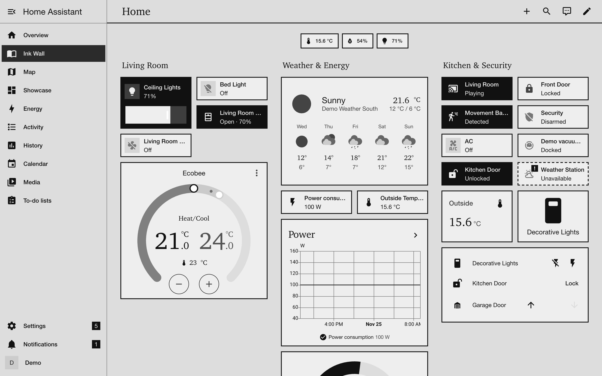
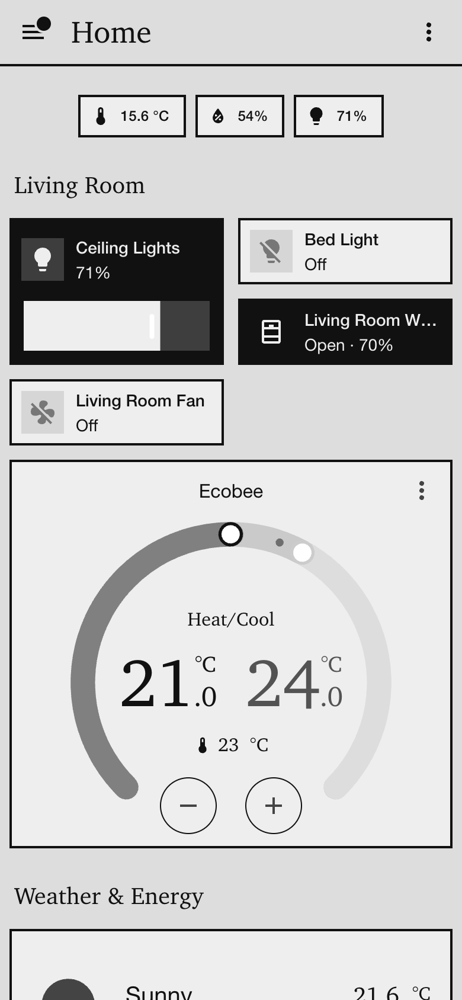
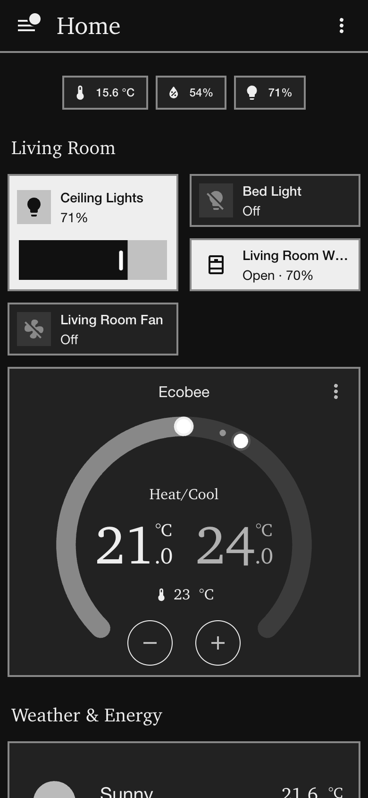
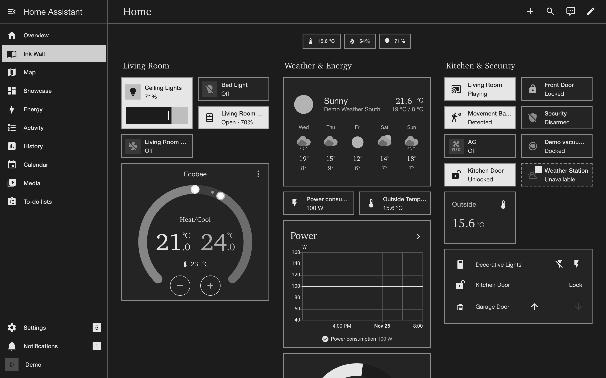
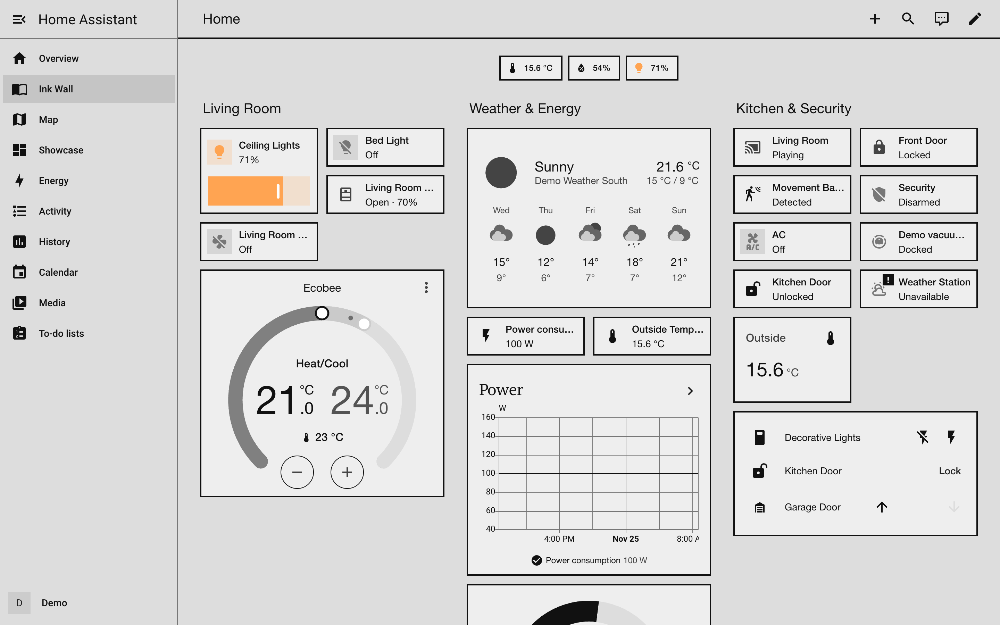
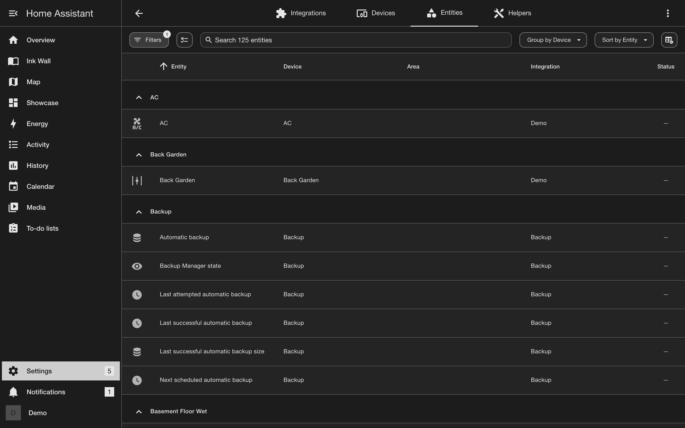

# Ink Wall

[](https://my.home-assistant.io/redirect/marketplace_repository/?owner=wsclx&repository=ink-wall-theme&category=theme)

A strictly monochrome theme for Home Assistant, made for e-paper and e-ink wall displays and for anyone who likes a quiet dashboard. Black ink on paper grey, 2 px rules, square corners, no shadows and no motion. Switched-on devices are solid ink tiles, everything that is off is only outlined. Numbers and titles are set in a book serif. Light and dark mode in one theme.



| Light | Dark |
|---|---|
|  |  |



## What you get

- **No hue in the dashboard.** Every state colour of Home Assistant is mapped to a grey: lights, heating, cooling, alarms, locks, batteries, weather, energy, graphs, buttons, alerts. The dashboard looks the same on a greyscale panel as on a colour screen.
- **States you can read without colour.** Strong states (on, heating, lit, open, triggered) are ink, calm states (locked, docked) are dark grey, off is mid grey. On the thermostat ring heating is ink and cooling light grey. Error notices sit on a darker grey than warnings, warnings darker than information. Icons and state text stay as they are, so a state never depends on grey value alone either.
- **Greys on the 16 levels of an e-ink panel.** Every grey of the theme is a multiple of `#111111`, one of the 16 levels a typical e-ink panel shows, so no two roles fall on the same level. Light mode: ink `#111111`, quiet text `#444444`, off `#777777`, slider track `#888888`, fills `#cccccc`, paper `#dddddd`, cards `#eeeeee`. On a 4-level panel paper and cards merge, and the 2 px rules carry the layout.
- **Flat and still.** Square corners, 2 px ink rules around every card with 12 px of paper between them, no shadows, no blur. Home Assistant's own animations are switched off.
- **States you can read from across the room.** The state line of a tile is as large as its name, not a small caption.
- **Book serif for numbers and titles** from the system: Charter on Apple devices (a typeface drawn for low-resolution printers), Palatino or Cambria on Windows, Noto Serif or DejaVu Serif on Android and Linux. Labels use Helvetica Neue or Arial. Nothing is downloaded.
- **Dark mode is its own design:** light ink on dark grey with grey rules, switched-on devices as light tiles with dark text. It is not an inverted light mode.
- **Optional extras with card-mod:** a tile prints in reverse, paper on ink, while its device is doing something or needs a look (on, open, unlocked, playing, heating or cooling, cleaning, triggered). Tiles of unavailable or unknown entities get a dashed rule. Big numbers and section headings switch to the serif, the selected sidebar entry becomes an ink bar, and badges show only two inks, so coloured lights lose their colour there.

Without card-mod the theme still works: cards, rules, greys, spacing and fonts stay, switched-on devices show an ink icon instead of a reversed tile, and headings use the label font.





## Requirements

- Home Assistant with themes enabled. Tested with Home Assistant 2026.11.2 (November 2026).
- Optional: [card-mod](https://github.com/thomasloven/lovelace-card-mod) 4.x for the solid ink tiles, the serif numbers and headings and the sidebar. Tested with card-mod 4.2.1.

## Installation

### Marketplace (HACS)

1. Open **Settings → Marketplace** (or HACS on older versions).
2. Search for **Ink Wall** and download it.
3. Reload themes: **Developer tools → Actions → `frontend.reload_themes`**.

### Manual

1. Copy `themes/ink_wall.yaml` into the `themes` folder of your configuration.
2. Make sure your `configuration.yaml` loads that folder:

   ```yaml
   frontend:
     themes: !include_dir_merge_named themes
   ```

3. Restart Home Assistant or run `frontend.reload_themes`.

## Use the theme

Open your **profile**, choose **Ink Wall** under *Theme*, and pick *Auto*, *Light* or *Dark*.

## On an e-paper or e-ink wall display

Most e-ink wall displays either run a web browser, or show an image of a dashboard that a server renders for them. Ink Wall works with both.

- **Give the display its own user.** Theme and mode are stored per user and per browser. Create a user for the wall display, log in once on the display, open the profile and choose **Ink Wall** with **Light**. Light mode is what e-paper shows best; *Auto* may switch to dark at night if the device reports a dark setting.
- **Browser in kiosk or full-screen mode.** Start the browser of the device in its kiosk or full-screen mode with the address of the dashboard, for example `http://homeassistant.local:8123/lovelace/0`. To hide the header and sidebar, use a kiosk plugin from the Marketplace or a dashboard made for the display.
- **Rendered images.** If your display shows an image that a server renders with a headless browser, log that browser in as the display user, or pass the theme to the renderer if it offers a theme setting. The page is already grey, so the conversion to the panel's grey levels loses nothing.
- **Fewer refreshes.** E-ink panels redraw slowly. Prefer cards that change rarely (temperatures, states, the weather forecast) over live graphs, cameras and media artwork, and give the display a long refresh interval.
- **Full refresh now and then.** A reversed tile turns a large area from paper to ink. Panels with partial refresh keep a faint ghost of it; let the display do a full refresh every few updates.
- **Large type.** Use tile and entity cards rather than dense lists, and raise the text size of the browser if the panel is far away.

## Optional: card-mod

The theme contains `card-mod-card`, `card-mod-badge`, `card-mod-root` and `card-mod-sidebar` rules. They only apply when card-mod is installed. For theme rules, card-mod recommends loading it as a frontend module instead of a dashboard resource:

```yaml
frontend:
  themes: !include_dir_merge_named themes
  extra_module_url:
    - /local/community/lovelace-card-mod/card-mod.js
```

Adjust the path to where card-mod is installed on your system.

The reversed tile follows the state, not the kind of device: `on`, `open`, `opening`, `closing`, `unlocked`, `unlocking`, `jammed`, `playing`, `heat`, `cool`, `heat_cool`, `auto`, `dry`, `fan_only`, `cleaning`, `returning`, `mowing`, `triggered`, `pending`, `arming`. A paused player, a locked door or an armed alarm stay outlined; a sensor showing a number never reverses. The dashed rule applies to the states `unavailable` and `unknown`.

## Customise

Change the variables below in a copy of the theme, or override them with card-mod.

| Variable | Used for |
|---|---|
| `ink-wall-ink`, `ink-wall-paper` | Ink and paper of solid tiles and the sidebar bar (card-mod), separate values for light and dark |
| `lovelace-background`, `card-background-color` | Paper behind the cards and of the cards |
| `ha-section-grid-row-gap`, `ha-section-grid-column-gap` | Paper between cards in a section |
| `ha-tile-info-secondary-font-size` | Size of the state line in tiles |
| `ha-card-border-color`, `ha-card-border-width` | The rule around every card |
| `ink-wall-serif`, `ink-wall-sans` | Font stacks for numbers and titles, and for labels |
| `state-active-color`, `state-inactive-color` | Grey of on and off icons |
| `red-color`, `amber-color`, `blue-color`, `green-color` … | The palette behind all state colours, each mapped to a grey |
| `graph-color-1` … `graph-color-5`, `energy-*-color` | Grey steps of graphs and the energy dashboard |

## Known limits

- Home Assistant does not guarantee theme variables between releases. If something looks off after an update, please open an issue with your version.
- **Coloured lights:** a light that reports a colour shows that colour in its tile icon, its brightness slider and its badge. The frontend sets it per light, so a theme cannot change it. With card-mod the tile turns ink and the badge grey; in the light's dialog the colour picker keeps its colours.
- **Patterns:** a theme can only set colours and, with card-mod, the style of a rule (the dashed rule of unavailable tiles), not hatching or dot patterns. States that used to differ by colour alone (armed and triggered alarms, errors and warnings) differ by grey value, icon and text. The weather icons are filled shapes, so the sun is a grey disc rather than a line drawing.
- Without card-mod a theme cannot fill a whole tile by its state or change its rule, only the icon. The reversed tile and the dashed rule need card-mod.
- Switches keep their round shape and a few frontend transitions (about 0.2 s) stay: both are fixed in the frontend. The press ripple is switched off on tiles with card-mod and wherever the frontend reads the theme value; some controls keep their own.
- Keyboard focus on a reversed tile is drawn in paper colour with card-mod; without card-mod it is a faint line. Wall displays are usually touch-only.
- Dark-mode colour scales follow the roles Home Assistant 2026.11 gives each step, not a smooth ramp. If buttons or alerts look wrong after a frontend update, please open an issue.
- Camera images, maps, media artwork and entity pictures keep their own colours, and so do the round icons of the settings menu and the logos of integrations.
- The serif depends on your device. Where none of the listed fonts is installed, the system serif is used.
- The card-mod rules target internal elements of the frontend. A frontend update can break them; the theme itself keeps working.

## Contributing

Issues and pull requests are welcome. Please include your Home Assistant version, card-mod version (if used), browser or display and a screenshot.

## License

[MIT](LICENSE)

This is a community project. It is not affiliated with or endorsed by Home Assistant or the Open Home Foundation.
